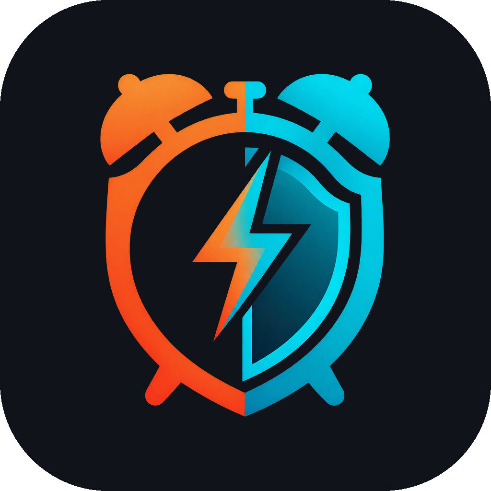

<p align="center">
  
</p>

<h1 align="center">WakeGuard</h1>

<p align="center"><strong>Wake up. Complete a challenge. Stay awake.</strong></p>

<p align="center">Free · Offline-first · No ads · No accounts</p>

<p align="center">
  <a href="#features">Features</a> ·
  <a href="#running">Getting started</a> ·
  <a href="docs/ARCHITECTURE.md">Architecture</a> ·
  <a href="docs/VERIFICATION.md">Verification</a>
</p>

An offline alarm clock for people who dismiss an alarm and fall back asleep.
Choose a wake challenge, practise it, and optionally ask WakeGuard to check
you are still up a few minutes later. Alarm readiness is visible before bed.

- **In development:** builds and real-device acceptance testing are pending;
  this is not yet a production-ready release.
- **Android-first.** An iOS target is included, but current development and
  release verification focus on Android.
- **Free, no ads, no analytics, no accounts.** Everything is stored on device.
- **Camera** is used only while a wake challenge is on screen. Frames are never
  saved or transmitted.

## Features

- **Simple / Challenge / Get out of bed presets:** tap to stop, a camera-free
  memory pattern, or a QR code placed away from bed. Face actions are also
  available. The two-minute hold always remains an escape.
- **Stay Awake:** opt into a check-in 3, 5 or 10 minutes after dismissal. Confirm
  with “I'm up” during the one-minute grace period; an unanswered check-in
  produces at most one follow-up alarm, with no snooze or further check-ins.
- **Practice:** use the real native challenge without scheduling, playing alarm
  audio, adding history or changing the next alarm. Back/Exit leaves practice.
- **Flexible mornings:** daily, selected days or one-time alarms; per-alarm
  snooze; skip the next repeat and resume automatically; duplicate switched off.
- **History:** started, snoozed, dismissed, missed and check-in outcomes with
  duration and snooze count. Streaks use completed interactions, excluding
  unscheduled weekdays for the current repeating schedule. History is bounded
  and can be deleted from the History tab.
- **Readiness:** blocking exact-alarm, notification and alarm-volume checks;
  camera/full-screen guidance; sound previews; next-date/time save feedback.
- **Privacy:** no account, ads or analytics; local processing and explicit
  Android backup/transfer exclusions. Uninstalling deletes local records.

## What makes an alarm ring

Android delivery and recovery use three complementary mechanisms:

1. `AlarmManager.setAlarmClock` schedules user-visible alarm-clock triggers
   that can fire during Doze.
2. **Watchdog rungs** at 45 s / 2 min / 5 min / 10 min
   (`setExactAndAllowWhileIdle`, armed relative to each ring's start)
   attempt to restart the foreground service if it stops mid-ring.
3. A **fallback notification** if Android refuses the foreground-service start,
   so the failure is visible instead of silent.

The wake challenge (`AlarmRingActivity`) is deliberately a plain Android
Activity, never a Flutter route: dismissing an alarm must not depend on the
Dart isolate booting. Each alarm carries the escapes it offers — face actions,
tap to stop, pattern, QR — and any one of them works, plus a two-minute hold that is always
available regardless of configuration.

## Layout

```
lib/
  core/        Alarm model, repository, reconcile, escalation, settings, streaks
  platform/    AlarmEngine contract + MethodChannel implementation
  ui/          Alarm editor, Health, History, Settings, onboarding
android/       Scheduler, persisted sessions, check-ins, ringing, health checks
ios/           iOS target and native platform integration
branding/      Vector logo and high-resolution artwork
docs/          Architecture and verification scenarios
```

The Dart side keeps a **mirror** of the alarm set for fast rendering; the
native store decides what actually rings. They are reconciled on every load
(`lib/core/reconcile.dart`): the platform wins on `enabled`, alarms the mirror
knows but the platform lost are re-scheduled, and alarms only the platform
knows are imported rather than dropped.

Details are in [`docs/ARCHITECTURE.md`](docs/ARCHITECTURE.md).

## Running

```sh
flutter pub get
flutter run            # debug; signing uses the debug key
flutter test
flutter analyze
```

Release signing is **not** set up yet: `android/app/build.gradle.kts` uses the
debug key and has `isMinifyEnabled = false`. Production signing is required;
release shrinking should be evaluated with the camera models and sound assets.

## Release roadmap

Current Android configuration:

- No device-admin or battery-optimisation exemption permissions.
- `SCHEDULE_EXACT_ALARM` limited to `maxSdkVersion="32"`; `USE_EXACT_ALARM`
  is the alarm-clock permission on 13+.
- No `ACCESS_NOTIFICATION_POLICY` permission; DND bypass is not promised.
- Foreground service is `mediaPlayback`, not `specialUse`.
- `android.hardware.camera.front` declared `required="false"` so camera-less
  devices are not filtered out.
- Blocking vs. warning severities: only exact alarms, alarm volume and
  notification permission block a save; full-screen intent and camera are
  warnings.

Before a public release:

- Run static analysis, Flutter/native tests, and the real-device scenarios in
  [`docs/VERIFICATION.md`](docs/VERIFICATION.md).
- Configure production signing and evaluate release shrinking.
- Capture real screenshots of the alarm editor, challenges, and Stay Awake
  flow for this README and the store listing.
- Publish a privacy policy and complete the store's data-safety declarations.
- Confirm current Play Console testing and submission requirements for the
  developer account, and complete any required closed testing.

## Contributing

Bug reports, accessibility improvements, and device-testing feedback are welcome.
For alarm-delivery issues, include the device model, Android version, steps to
reproduce, and whether the phone was locked or the app was backgrounded.

See [`docs/VERIFICATION.md`](docs/VERIFICATION.md) for checks and device scenarios.

## License

WakeGuard's original source code is licensed under the [MIT License](LICENSE).
Third-party dependencies and assets retain their respective licenses.
