<p align="center">
  
</p>

<h1 align="center">WakeGuard</h1>

<p align="center"><strong>Wake up. Complete a challenge. Stay awake.</strong></p>

<p align="center">Free · Offline-first · No ads · No accounts</p>

<p align="center">
  <a href="#features">Features</a> ·
  <a href="#running">Getting started</a> ·
  <a href="docs/ARCHITECTURE.md">Architecture</a> ·
  <a href="docs/VERIFICATION.md">Verification</a>
</p>

An offline alarm clock for people who dismiss an alarm and fall back asleep.
Choose a wake challenge, practice it, and optionally ask WakeGuard to check
you are still up a few minutes later. Alarm readiness is visible before bed.

- **In development:** builds and real-device acceptance testing are pending;
  this is not yet a production-ready release.
- **Android-first.** An iOS target is included, but current development and
  release verification focus on Android.
- **Free, no ads, no accounts.** Alarm records stay on device; Google ML Kit's
  SDK diagnostics are disclosed in the Privacy policy.
- **Camera** is used only while a wake challenge is on screen. Frames are never
  saved or transmitted.

## Features

- **Simple / Challenge / Get out of bed presets:** optional Tap, Face actions,
  or Find an object placed away from bed. Object targets are Sink (recommended),
  and Cup, using exact labels in a bundled offline model. Sink scans tolerate brief
  detection dropouts without counting missing frames toward completion. A successful
  three-second practice scan is required before enabling an Object alarm. QR is
  also selectable. Hold-to-stop and Pattern have been removed on Android.
- **Animated native challenges:** framing guides, recognition-backed progress,
  step transitions and a short success screen after sound stops. System animation
  settings are respected. Face does not override screen brightness or offer a slider;
  use a well-lit room.
- **Stay Awake:** opt into a check-in 3, 5 or 10 minutes after dismissal. Confirm
  when a short notification sound prompts you, using “I'm up” during the
  one-minute grace period; an unanswered check-in
  produces at most one follow-up alarm, with no snooze or further check-ins.
- **Practice:** use the real native challenge without scheduling, playing alarm
  audio, adding history or changing the next alarm. Back/Exit leaves practice.
- **One wake-up QR:** print once and reuse it for new QR alarms. Show or export
  it from Settings; existing per-alarm codes remain valid, and custom codes are
  still available in the editor.
- **Flexible mornings:** daily, selected days or one-time alarms; per-alarm
  snooze; skip the next repeat and resume automatically; duplicate switched off.
- **History:** started, snoozed, dismissed, missed and check-in outcomes with
  duration and snooze count. Streaks use completed interactions, excluding
  unscheduled weekdays for the current repeating schedule. History is bounded
  and can be deleted from the History tab.
- **Readiness:** blocking exact-alarm, notification and alarm-volume checks;
  camera permission required to save or enable Face/Object/QR alarms; full-screen
  guidance; sound previews; next-date/time save feedback.
- **Privacy:** no accounts or ads; on-device camera processing and explicit
  Android backup/transfer exclusions. Uninstalling deletes local records. See
  `docs/wakeguard-privacy.html` for local data and third-party SDK diagnostics.

## Screenshots

Captured on a Samsung SM-A075F physical device (720×1600). Home contains sample
alarms; History includes a completed scheduled alarm. Challenge images show
practice mode.

<p align="center">
  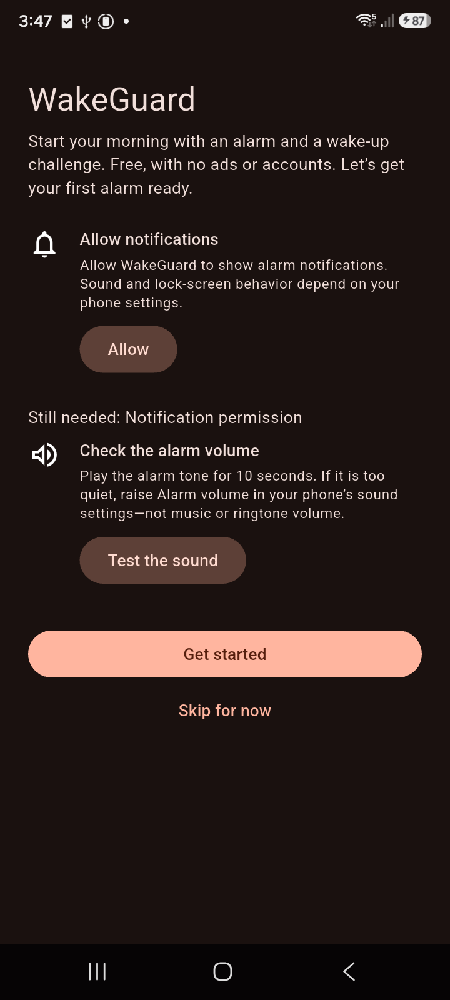
  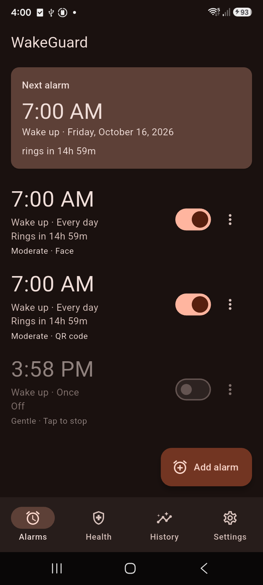
  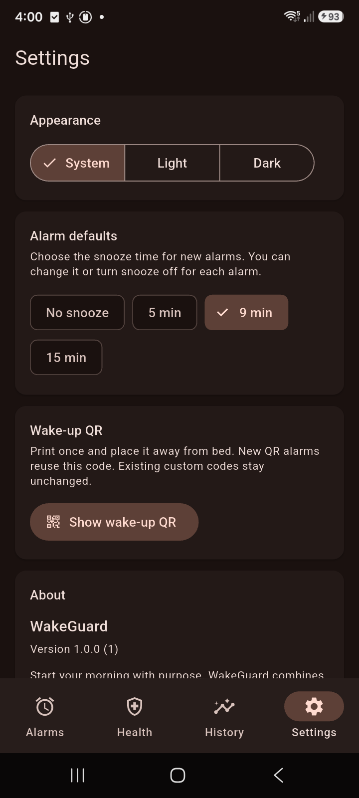
  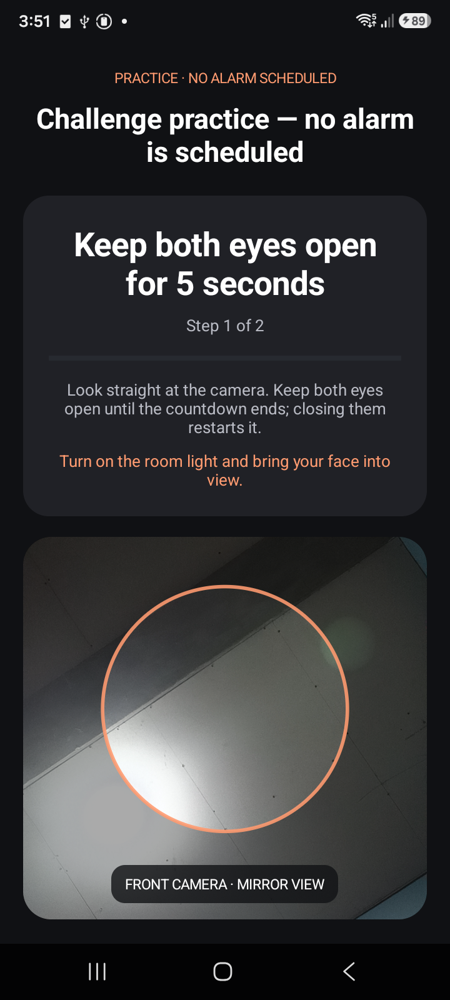
  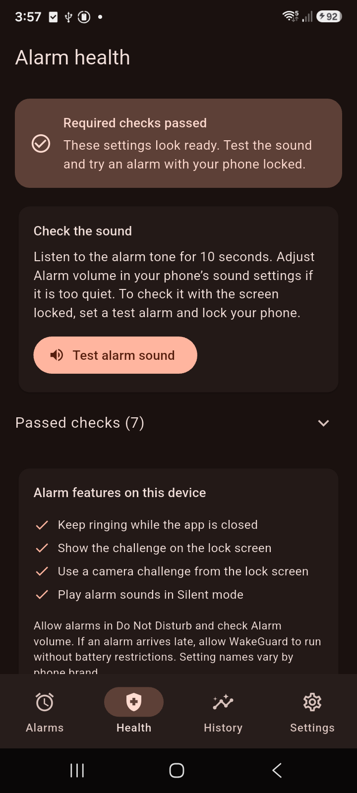
  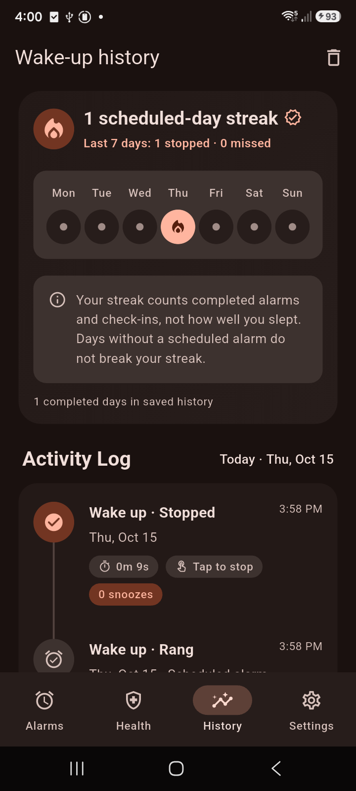
</p>

<p align="center"><sub>Onboarding · Alarms · Settings · Challenge · Health · History</sub></p>

<p align="center">
  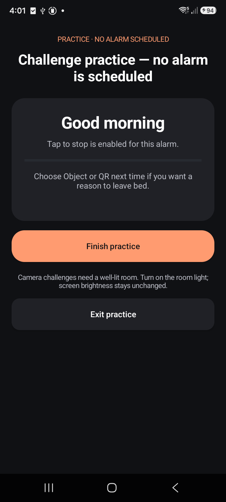
  
  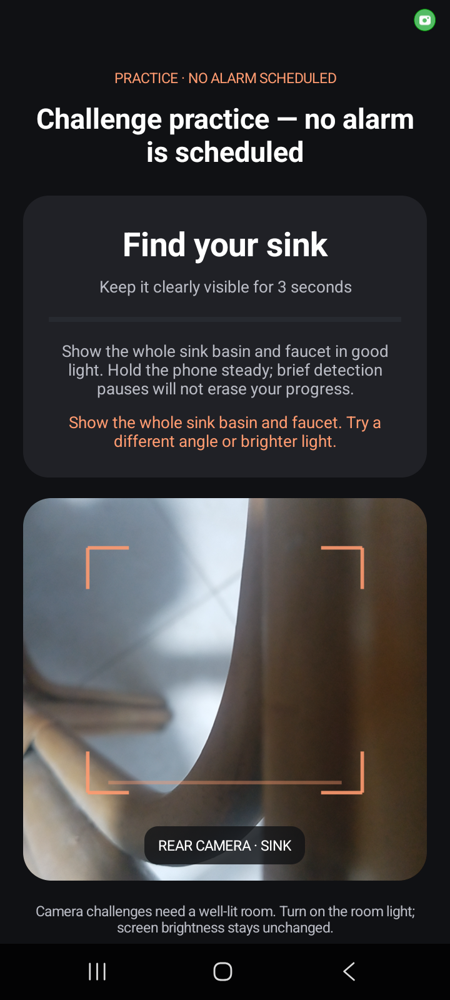
  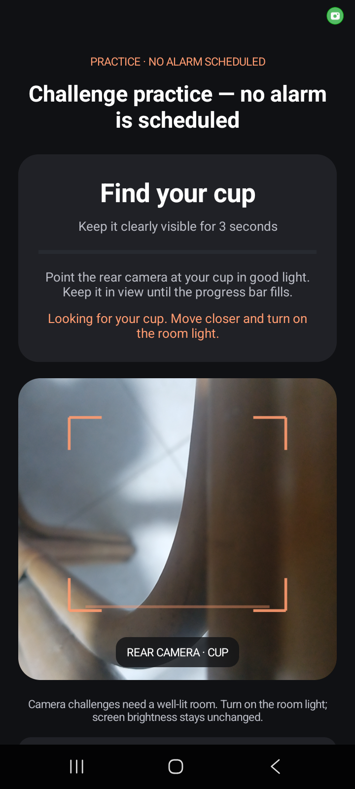
  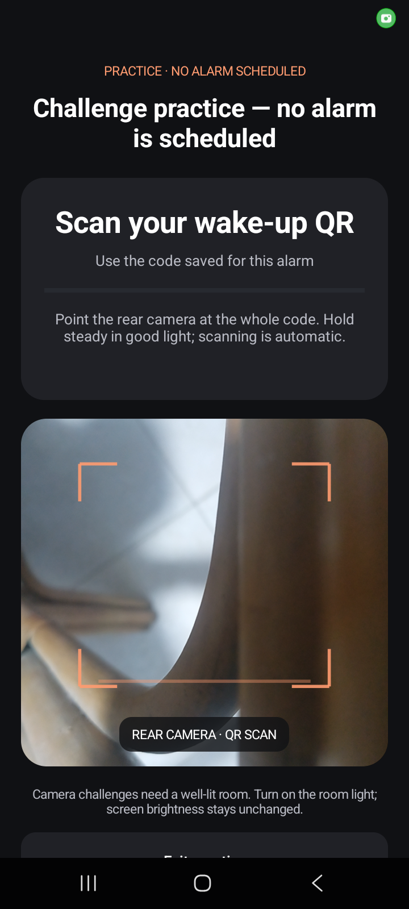
</p>

<p align="center"><sub>Tap to stop · Face · Sink · Cup · QR code</sub></p>

<p align="center">
  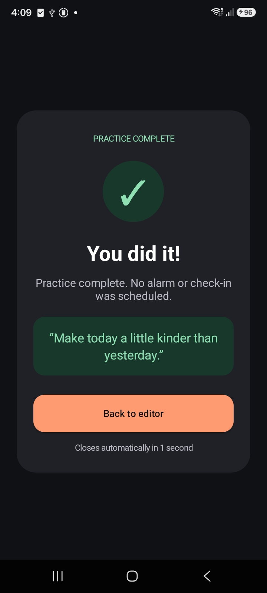
</p>

<p align="center"><sub>Challenge success</sub></p>

## What makes an alarm ring

Android delivery and recovery use three complementary mechanisms:

1. `AlarmManager.setAlarmClock` schedules user-visible alarm-clock triggers
   that can fire during Doze.
2. **Watchdog rungs** at 45 s / 2 min / 5 min / 10 min
   (`setExactAndAllowWhileIdle`, armed relative to each ring's start)
   attempt to restart the foreground service if it stops mid-ring.
3. A **fallback notification** if Android refuses the foreground-service start,
   so the failure is visible instead of silent.

The wake challenge (`AlarmRingActivity`) is deliberately a plain Android
Activity, never a Flutter route: dismissing an alarm must not depend on the
Dart isolate booting. Each alarm carries the escapes it offers — face actions,
tap to stop, pattern, QR — and any one of them works, plus a one-minute hold that is always
available regardless of configuration.

## Layout

```
lib/
  models/      Pure domain types: alarm, escalation, reconcile, stats, settings, health
  features/    Feature-first slices: controllers, repositories, screens and view models
    alarms/      Alarm controller, repository, list + editor UI
    challenges/  Wake-up QR codes and the shareable QR sheet
    health/      Readiness checks screen
    history/     Streak, stats and the dismissal log screen
    settings/    Preferences controller and settings screen
    onboarding/  First-run setup
    shell/       Tab shell and the alarm-editor routing flow
  shared/      View-model base + provider
  platform/    AlarmEngine contract + MethodChannel implementation
android/       Scheduler, persisted sessions, check-ins, ringing, health checks
ios/           iOS target and native platform integration
branding/      Vector logo and high-resolution artwork
docs/          Architecture and verification scenarios
```

The Dart side keeps a **mirror** of the alarm set for fast rendering; the
native store decides what actually rings. They are reconciled on every load
(`lib/models/reconcile.dart`): Android wins on configuration and `enabled`, alarms the mirror
knows but the platform lost are re-scheduled, and alarms only the platform
knows are imported rather than dropped.

Details are in [`docs/ARCHITECTURE.md`](docs/ARCHITECTURE.md).

## Running

```sh
flutter pub get
flutter build apk --debug
flutter build apk --release
flutter build appbundle --release
```

Or via the Makefile (`make help` lists everything):

```sh
make release-key     # once: create the upload keystore
make release         # checks + tests + signed AAB and APK
make release-verify  # verify every AAB entry against the configured upload key
```

Android's application ID, namespace and Kotlin package are `com.bling.wakeguard`.
The release uses a real upload key configured in gitignored `android/key.properties`
or signing environment variables. It never falls back to debug signing. See
[`docs/ANDROID_RELEASE.md`](docs/ANDROID_RELEASE.md). Target/compile SDK is at least
36. Release shrinking remains off until the camera models have been validated.

## Release roadmap

Current Android configuration:

- No device-admin or battery-optimisation exemption permissions.
- `SCHEDULE_EXACT_ALARM` limited to `maxSdkVersion="32"`; `USE_EXACT_ALARM`
  is the alarm-clock permission on 13+.
- No `ACCESS_NOTIFICATION_POLICY` permission; DND bypass is not promised.
- Foreground service is `mediaPlayback`, not `specialUse`.
- `android.hardware.camera.front` declared `required="false"` so camera-less
  devices are not filtered out.
- Blocking vs. warning severities: only exact alarms, alarm volume and
  notification permission are globally blocking. Camera permission additionally
   blocks Face/Object/QR saves and enables; optional Tap needs no camera. Full-screen
  intent is advisory.

Before a public release:

- Build the signed AAB and complete the real-device scenarios in
  [`docs/VERIFICATION.md`](docs/VERIFICATION.md).
- Back up the upload key and signing credentials and evaluate release shrinking.
- Capture real screenshots of the alarm editor, challenges, and Stay Awake
  flow for this README and the store listing.
- Publish a privacy policy and complete the store's data-safety declarations.
- Confirm current Play Console testing and submission requirements for the
  developer account, and complete any required closed testing.

## Contributing

Bug reports, accessibility improvements, and device-testing feedback are welcome.
For alarm-delivery issues, include the device model, Android version, steps to
reproduce, and whether the phone was locked or the app was backgrounded.

See [`docs/VERIFICATION.md`](docs/VERIFICATION.md) for checks and device scenarios.

## License

WakeGuard's original source code is licensed under the [MIT License](LICENSE).
Third-party dependencies and assets retain their respective licenses.
